# MiniGPT: a small GPT-style language model built from scratch

A decoder-only Transformer with **0.81 M parameters**, written in PyTorch and trained from random initialisation on **Tiny Shakespeare**. It generates text one character at a time.

No pretrained checkpoint is loaded, and no high-level architecture class is used (no `nn.MultiheadAttention`, no Hugging Face `transformers`). From PyTorch the model uses only matrix multiplication, softmax, `nn.Linear`, `nn.LayerNorm`, autograd and AdamW, which the assignment handout explicitly allows. Attention, multi-head split/merge, the causal mask, positional encoding, the Transformer block, the LM head, the training loop and sampling are all implemented in this repository.

<p align="center">
  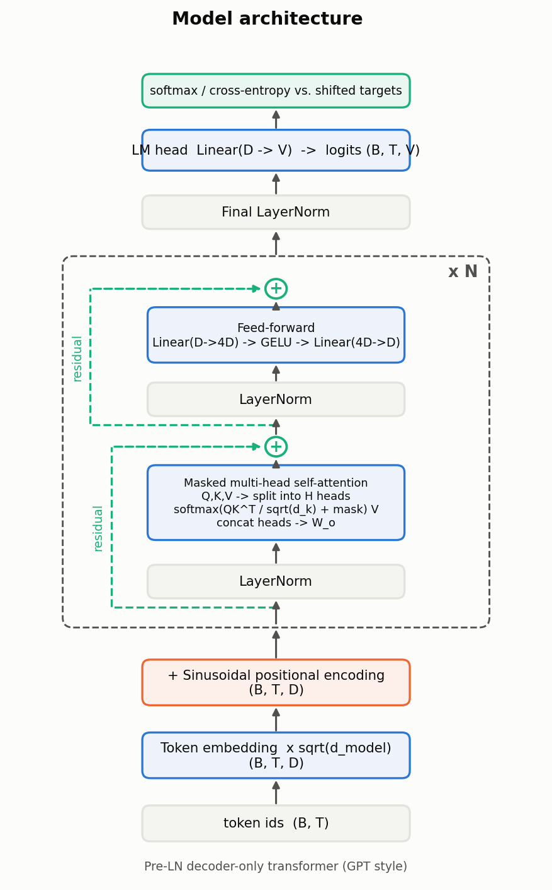
</p>

| Links | |
|---|---|
| Live API (Render) | https://minigpt-3s94.onrender.com (interactive docs at [`/docs`](https://minigpt-3s94.onrender.com/docs)) |
| GitHub repository | https://github.com/layyana-junaid/AI_Engineering_Fall26 |
| Colab notebook (executed, with outputs) | https://colab.research.google.com/drive/1YSdpHDZLwyR2QuKKbqh95UPniUau5Mui?usp=sharing (repository copy: [`notebooks/colab_minigpt.ipynb`](notebooks/colab_minigpt.ipynb)) |
| Technical report | [`report/report.pdf`](report/report.pdf); Medium: `<YOUR_MEDIUM_URL>` |
| Demo video | https://canva.link/cfyxr0j21he6h7v |

---

## Contents

1. [Results at a glance](#results-at-a-glance)
2. [Quick start](#quick-start)
3. [Repository layout](#repository-layout)
4. [Model and training configuration](#model-and-training-configuration)
5. [Evidence figures](#evidence-figures)
6. [Ablation study](#ablation-study)
7. [Inference: CLI and REST API](#inference-cli-and-rest-api)
8. [Reproducing everything](#reproducing-everything)
9. [Tests](#tests)
10. [Design decisions](#design-decisions)
11. [Known limitations](#known-limitations)
12. [Sources and attribution](#sources-and-attribution)

---

## Results at a glance

| Final model | |
|---|---|
| Parameters | 810,240 (0.81 M; 3.1 MiB in fp32) |
| Architecture | 4 layers, 4 heads, d_model 128, FFN 512, context 128, dropout 0.1, sinusoidal positions |
| Data | Tiny Shakespeare, 1,115,394 characters; 90 % train / 10 % validation (contiguous split) |
| Tokenizer | Character level, vocabulary 66 (65 characters + `<unk>`) |
| Training | 3,000 steps, batch 64 × 128 tokens, AdamW, lr 1e-3 with warm-up and cosine decay |
| Hardware / time | 2-core CPU, 38.5 min (≈10.6 k tokens/s) |
| **Validation** | **loss 1.645 nats/char, perplexity 5.18, 2.37 bits/char** (full held-out split) |
| Training | loss 1.450 (perplexity 4.26) |
| Baseline | uniform guess = ln(66) = 4.19 nats/char |

A sample from the final model (prompt `ROMEO:`, temperature 0.8, top-k 40):

```text
ROMEO:
If they world, but they to son.

CAMILLO:
As my lord, now legs in him: I fay, I see not
Reeson of the known that will name it, day your worse,
With is thou hast swear not intermits,
```

The model has learned the *format* of a play (speaker names in capitals, colons, line breaks, verse-length lines) and many real words. It still invents words and has no long-range coherence. See [Known limitations](#known-limitations).

---

## Quick start

Requires Python 3.10+.

```bash
git clone https://github.com/layyana-junaid/AI_Engineering_Fall26.git transformer-gpt-assignment
cd transformer-gpt-assignment

python -m venv .venv
source .venv/bin/activate          # Windows: .venv\Scripts\activate
pip install -r requirements.txt

python -m src.dataset --download   # Tiny Shakespeare -> data/input.txt
python -m pytest -q                # 36 tests

# Generate with the trained checkpoint that ships in the repo
python -m src.generate --prompt "ROMEO:" --max-new-tokens 200 --temperature 0.8
```

The trained weights (`checkpoints/minigpt.pt`, 3 MB) are committed, so you don't need to train before generating.

**On Google Colab:** open the [shared notebook](https://colab.research.google.com/drive/1YSdpHDZLwyR2QuKKbqh95UPniUau5Mui?usp=sharing), which already contains the outputs of a full run. To run it again yourself, open [`notebooks/colab_minigpt.ipynb`](notebooks/colab_minigpt.ipynb) in Colab, select *Runtime → Change runtime type → T4 GPU*, and run all cells. The first cell clones this repository, so it must be public. The full pipeline takes a few minutes on a T4, and the ablation step takes longer.

---

## Repository layout

```text
configs/tiny_gpt.yaml           every hyper-parameter; override any of them with --set key=value
data/                           Tiny Shakespeare is downloaded here (git-ignored)
src/
  tokenizer.py                  deterministic character tokenizer with a documented <unk> policy
  dataset.py                    contiguous split, random windows, shifted targets (y[t] = x[t+1])
  attention.py                  causal_mask, scaled_dot_product_attention, MultiHeadAttention (explicit split/merge)
  positional_encoding.py        sinusoidal (required) + learned (ablation)
  transformer_block.py          pre-LN decoder block: LN -> MHA -> +residual, LN -> GELU FFN -> +residual
  gpt.py                        embedding + position + N blocks + final LN + LM head + cross-entropy
  train.py                      AdamW, warm-up/cosine LR, grad clipping, eval, logging, checkpointing, overfit gate
  generate.py                   autoregressive sampling (temperature, top-k, top-p, greedy) + CLI
  evaluate.py                   full-split loss / perplexity + fixed-prompt samples
  api.py                        FastAPI service (/, /health, /generate)
tests/                          pytest suite (36 tests)
experiments/                    hand calculation, evidence figures, attention maps, ablations, MLM vs CLM, sampling study
reference/numpy_llm/            earlier pure-NumPy implementation with hand-written backprop
notebooks/colab_minigpt.ipynb   one-click Colab runner
outputs/figures/                all figures shown in this README
outputs/logs/                   metrics (JSONL), run summaries, text evidence
outputs/samples/                generated text from every run
checkpoints/minigpt.pt          trained weights (3 MB)
report/                         technical report (report.pdf)
Dockerfile, render.yaml         deployment
```

| Where is... | File |
|---|---|
| the model | [`src/gpt.py`](src/gpt.py), [`src/transformer_block.py`](src/transformer_block.py), [`src/attention.py`](src/attention.py) |
| the data pipeline | [`src/tokenizer.py`](src/tokenizer.py), [`src/dataset.py`](src/dataset.py), [`data/README.md`](data/README.md) |
| the tests | [`tests/`](tests/) |
| the experiments | [`experiments/`](experiments/) |
| the report | [`report/report.pdf`](report/report.pdf) |

---

## Model and training configuration

All values live in [`configs/tiny_gpt.yaml`](configs/tiny_gpt.yaml) and can be overridden from the command line, e.g. `--set model.n_layers=6 --set train.lr=3e-4`.

| Parameter | Value | Note |
|---|---|---|
| `vocab_size` | 66 | set by the tokenizer at train time |
| `context_length` | 128 | |
| `d_model` | 128 | |
| `n_heads` | 4 | head dim 32 |
| `n_layers` | 4 | |
| `ffn_dim` | 512 | 4 × d_model |
| `dropout` | 0.1 | |
| `pos_encoding` | sinusoidal | `learned` available for the ablation |
| `tie_weights` | false | optional experiment |
| optimizer | AdamW, β = (0.9, 0.95), weight decay 0.1 | decay on weight matrices only |
| learning rate | 1e-3, 100 warm-up steps, cosine to 1e-4 | handout suggests ~3e-4; this small model with a short budget tolerates more |
| gradient clipping | 1.0 | |
| batch size | 64 | |
| steps | 3,000 | |
| seed | 1337 | |
| generation temperature | 0.8 (top-k 40) | |

The model is smaller than the handout's upper suggestion (d_model 256) because it was trained on a 2-core CPU. The ablations below show depth still helps at this scale, so a larger model would likely do better given more compute.

---

## Evidence figures

All figures are generated by the scripts in [`experiments/`](experiments/) and saved to [`outputs/figures/`](outputs/figures/). The numbers in the matching text logs are in [`outputs/logs/`](outputs/logs/).

### Figure 1: Hand-calculated attention

A 3-token example with d_k = d_v = 2, worked step by step: `QKᵀ`, scaling by √d_k, row-wise softmax, and multiplication by V. The script checks the result against `src.attention.scaled_dot_product_attention`.

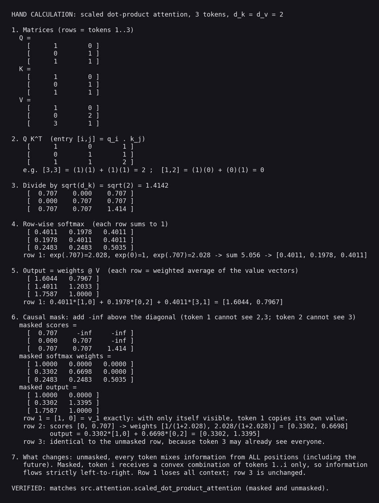

Full worked numbers: [`outputs/logs/hand_calculation.txt`](outputs/logs/hand_calculation.txt). With the causal mask, row 1 becomes `[1, 0, 0]`, so token 1 simply copies its own value vector. Token 2 mixes tokens 1–2 with weights `[0.330, 0.670]`. Token 3 is unchanged because it could already see every position.

**Handwritten working.** The same calculation done by hand, step by step, from X and the weights to the masked output (`outputs/hw.jpeg`, `outputs/hw2.jpeg`, `outputs/hw3.jpeg`):

| Page | Contents | File |
|---|---|---|
| 1 | Input X, weights, Q, K, V, and Q·Kᵀ | [`outputs/hw.jpeg`](outputs/hw.jpeg) |
| 2 | Scaling, softmax without the mask, and the unmasked output | [`outputs/hw2.jpeg`](outputs/hw2.jpeg) |
| 3 | Causal mask, masked softmax, and the masked output | [`outputs/hw3.jpeg`](outputs/hw3.jpeg) |

The handwritten values match the script's values. Two entries differ only in the last digit because of rounding: the handwritten page adds the rounded weights for token 3 (0.2483 + 0.5035 × 3 = 1.7588), while the script uses unrounded weights and gets 1.7587. The masked output for token 2 is 1.3396 by hand (0.6698 × 2), and the saved log `outputs/logs/hand_calculation.txt` prints 1.3395.

### Figure 2: Causal mask

A strictly upper-triangular boolean mask, filled with `-inf` before the softmax, so future positions receive exactly zero attention weight.

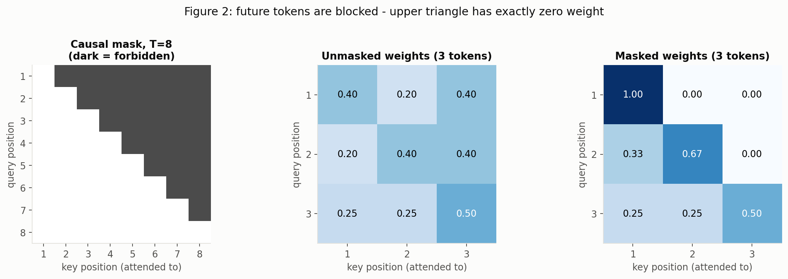

### Figure 3: Multi-head tensor-shape trace

Each step of multi-head attention, from `(B, T, D)` through the Q/K/V projections, the split into `(B, H, T, D/H)`, per-head attention, the merge back to `(B, T, D)`, and the output projection.

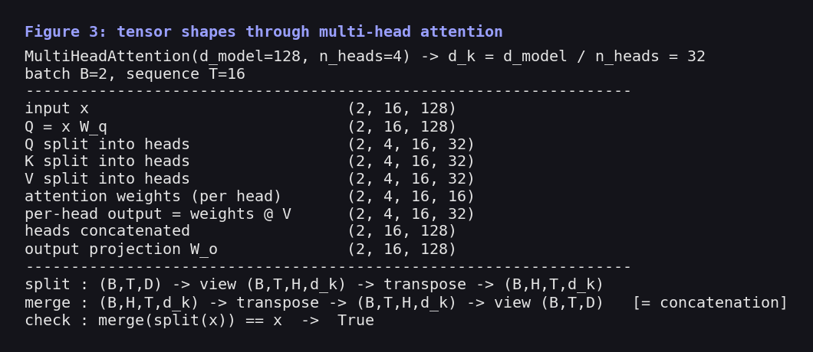

Text version: [`outputs/logs/shape_trace.txt`](outputs/logs/shape_trace.txt).

### Figure 4: Sinusoidal positional encoding

Left: the full 128 × 128 table. Middle: low dimensions oscillate quickly and high dimensions slowly, so every position gets a unique signature. Right: the dot product between position 40 and every other position peaks at 40 itself and falls off with distance.

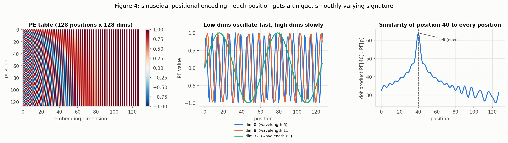

### Figure 5: Model summary and parameter count

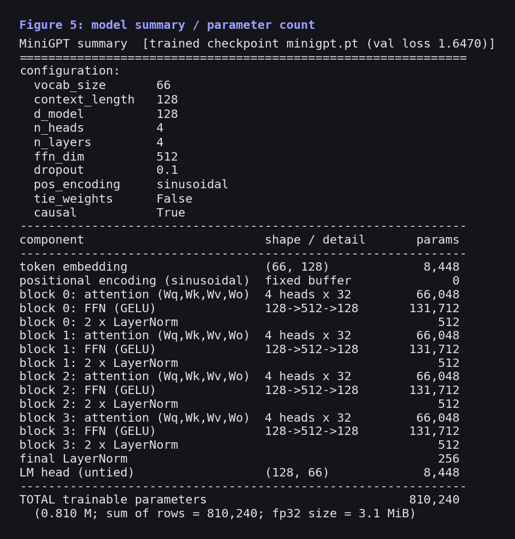

Text version: [`outputs/logs/model_summary.txt`](outputs/logs/model_summary.txt).

### Figure 6: Training and validation loss

The loss starts at 4.22, close to the uniform-guess value ln(66) = 4.19, which confirms the untrained model is correctly uniform. It ends at a validation loss of 1.647. The right panel shows the warm-up + cosine learning-rate schedule.

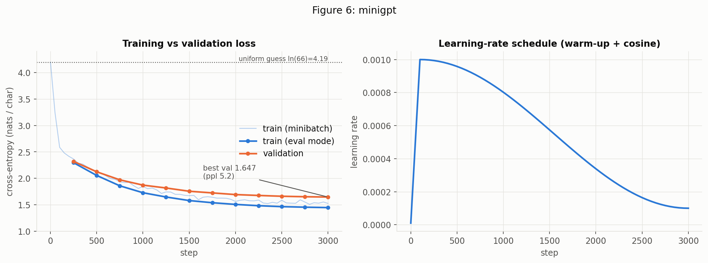

The validation loss was still falling at step 3,000, so the model had not converged.

**Debugging gate.** Before the full run, the model was overfit on a single repeated batch: the loss fell from 4.2 to 0.07 in 300 steps ([`outputs/logs/overfit/summary.json`](outputs/logs/overfit/summary.json)). This shows that gradients flow and the targets are shifted correctly.

### Figure 7: Attention maps from the trained model

All 16 heads (4 layers × 4 heads) on the prompt `ROMEO:\nO, speak again, bright angel!`. Rows are queries and columns are keys. The upper triangle is empty because of the causal mask.

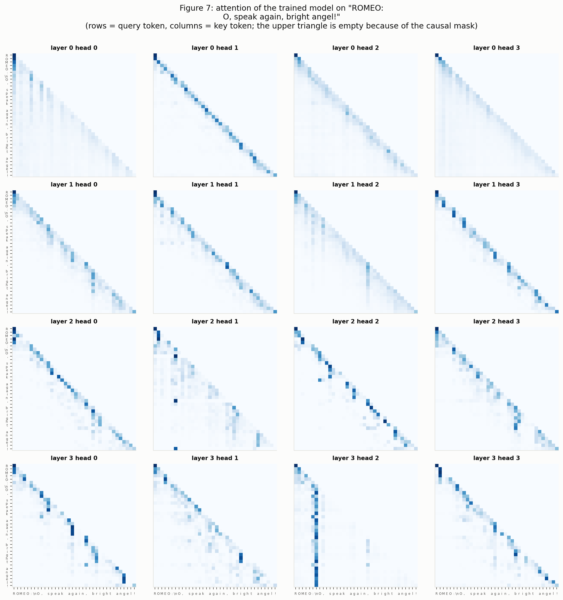

What the maps show:

* **Previous-character heads.** Layer 0 head 1 puts on average 50 % of its weight on the previous character (a sharp sub-diagonal).
* **Word-start heads.** Several deeper heads (e.g. layer 2 head 2, layer 3 head 0) focus on the first letter of the current word.
* **Anchor head.** Layer 3 head 2 attends almost entirely to the newline after `ROMEO:`, i.e. to the start of the current speech.

Per-head statistics: [`outputs/logs/attention_stats.txt`](outputs/logs/attention_stats.txt).

### Figure 8: Generation samples

Five fixed prompts, temperature 0.8, top-k 40. They are produced by `python -m src.evaluate` and saved in [`outputs/samples/eval_samples.txt`](outputs/samples/eval_samples.txt).

<details>
<summary><b>Show all five samples</b></summary>

```text
##### sample 1   prompt = 'ROMEO:'
ROMEO:
If they world, but they to son.

CAMILLO:
As my lord, now legs in him: I fay, I see not
Reeson of the known that will name it, day your worse,
With is thou hast swear not intermits,
With on the crown by on a men against of see
And he opisale to it.

##### sample 2   prompt = 'To be, or not to be'
To be, or not to be thee
With made ere him with an the could?

CLIFFORD:
Sunpar for Pardon, and desires, well:
Where were the combled friends: therefore:

##### sample 3   prompt = 'KING HENRY:\n'
KING HENRY:
Ah, you are by have speak come many good from thou have
In ever him to thirs in the grief be to being
Pempt was you bark, my countly give majesty,
Thou hast the wat we cault with us dear our forth.

##### sample 4   prompt = 'First Citizen:\nBefore we proceed'
First Citizen:
Before we proceed will go unto my lastifish,
Which gentlement for his both it the to cower:
Of cannot man's be and moder to me thee wast.

ROMEO:
See, my lord.

##### sample 5   prompt = 'O Juliet, '
O Juliet, poor Romeo and right
That setlems for my life, on Henry's with thee,
The work and ever not stand to the kingnow.

JULIET:
Why, have that as man with a world
```

</details>

### Figure 9: Ablation results

See [Ablation study](#ablation-study) below.

### Figure 10: CLI and API inference

The packaged model, called from the command line (10a) and over HTTP (10b):

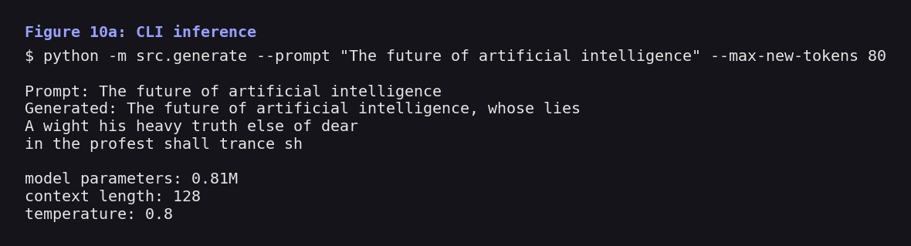

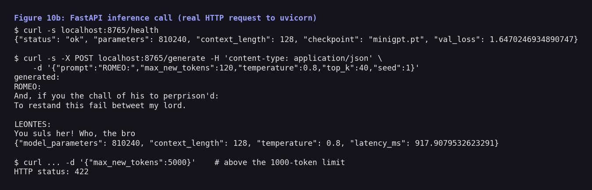

### Additional evidence

**Why Transformers: sequential vs parallel depth.** One RNN layer and one Transformer block were compared at d = 128, batch 16, forward + backward on CPU. The RNN needs T sequential steps; the Transformer block needs a constant number of sequential matrix multiplications, but its attention weights grow as T².

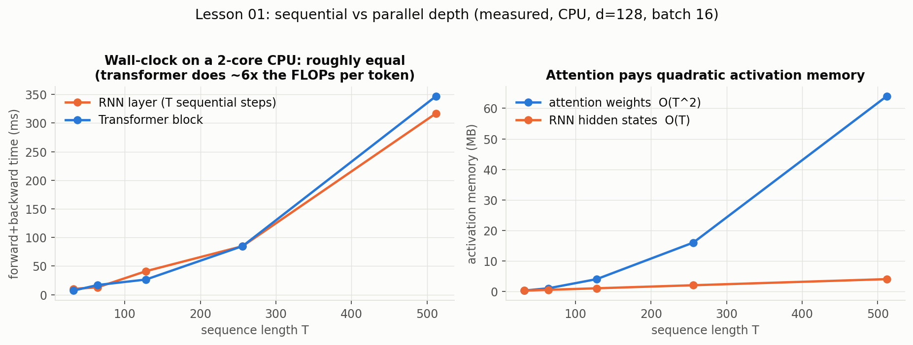

| T | RNN (ms) | Transformer block (ms) | RNN sequential steps | attention weights (MB) | RNN hidden states (MB) |
|---:|---:|---:|---:|---:|---:|
| 32 | 10.1 | 7.1 | 32 | 0.25 | 0.25 |
| 128 | 41.0 | 26.4 | 128 | 4.0 | 1.0 |
| 512 | 317.0 | 347.1 | 512 | 64.0 | 4.0 |

On a 2-core CPU there is little hardware parallelism to exploit, so wall-clock times are similar. The structural difference (T sequential steps vs a constant number) and the T² memory cost are the main points. Full table: [`outputs/logs/seq_vs_parallel.csv`](outputs/logs/seq_vs_parallel.csv).

**BERT (bidirectional) vs GPT (causal) masking.** The same model was trained twice on next-character prediction: once with the causal mask and once with a bidirectional (BERT-style) mask.

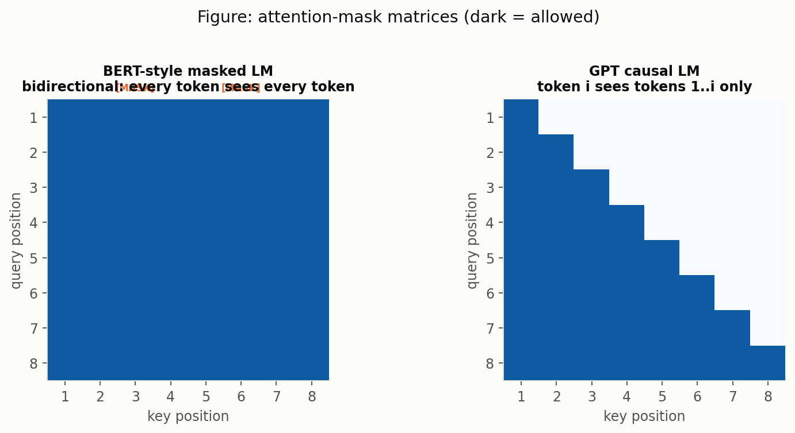

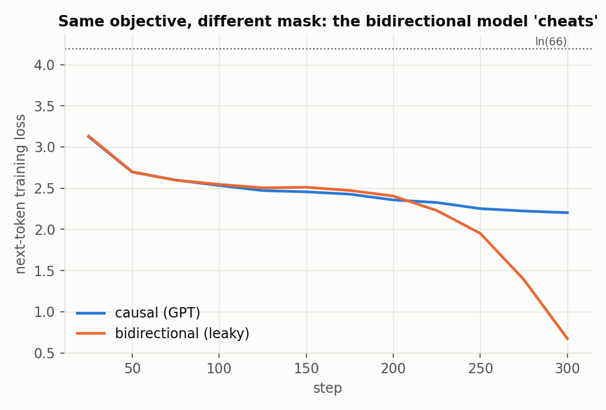

| Mask during training | val loss (same mask) | val loss under a causal mask (as in generation) |
|---|---:|---:|
| causal (GPT) | 2.255 | 2.255 |
| bidirectional | **0.678** | **5.692** |

The bidirectional model reaches a suspiciously low loss because it can see the token it is supposed to predict. When it is forced to work like a generator (no future context), its loss is 5.69, worse than a uniform guess. This is why a GPT must use a causal mask for next-token prediction, while BERT uses bidirectional attention with a different objective (predicting masked-out tokens). Source: [`experiments/mlm_vs_clm.py`](experiments/mlm_vs_clm.py).

---

## Ablation study

Each run changes one factor relative to the baseline (4 layers, 4 heads, context 128, sinusoidal positions). Because of CPU limits, ablations use a reduced budget: **800 steps, batch 32 × 128 tokens, one seed**. Re-running the baseline with a different seed gives 2.138 vs 2.157, so **differences smaller than about 0.02 are noise** (the grey band in the plot).

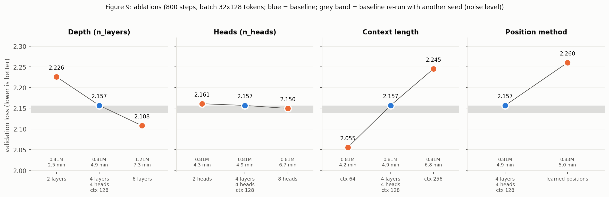

| run | setting | params | val loss | val ppl | train loss | time (s) | tokens/s | peak mem (MB) |
|---|---|---:|---:|---:|---:|---:|---:|---:|
| **base** | 4 layers / 4 heads / ctx 128 | 810,240 | **2.157** | 8.64 | 2.105 | 296.8 | 11,042 | 1087 |
| depth2 | 2 layers | 413,696 | 2.226 | 9.26 | 2.190 | 150.0 | 21,847 | 889 |
| depth6 | 6 layers | 1,206,784 | 2.108 | 8.23 | 2.048 | 437.2 | 7,495 | 1222 |
| heads2 | 2 heads | 810,240 | 2.161 | 8.68 | 2.113 | 256.7 | 12,767 | 989 |
| heads8 | 8 heads | 810,240 | 2.150 | 8.58 | 2.098 | 402.1 | 8,150 | 1281 |
| ctx64 | context 64 | 810,240 | 2.055 | 7.81 | 1.997 | 249.3 | 13,144 | 987 |
| ctx256 | context 256 | 810,240 | 2.245 | 9.44 | 2.214 | 409.5 | 8,002 | 1233 |
| learnedpos | learned positions | 826,624 | 2.260 | 9.58 | 2.228 | 301.2 | 10,878 | 1064 |

Raw data: [`outputs/ablation/results.csv`](outputs/ablation/results.csv). Per-run logs and samples: `outputs/logs/abl_*/` and `outputs/samples/abl_*.txt`.

| Finding | Observation |
|---|---|
| Depth helps, at a cost | val loss 2.226 → 2.157 → 2.108 for 2 → 4 → 6 layers; training time 150 → 297 → 437 s |
| Head count has no measurable effect | 2 / 4 / 8 heads = 2.161 / 2.157 / 2.150, all inside the noise band |
| Shorter context trained faster in this budget | context 64 / 128 / 256 = 2.055 / 2.157 / 2.245. This is confounded: with a fixed batch of 32 windows, longer contexts see more tokens per step but get fewer optimiser updates per token, and the runs are early in training |
| Sinusoidal beats learned positions here | 2.157 vs 2.260; learned embeddings must be learned from scratch in 800 steps, while the sinusoidal table is useful from step 0 |
| Sampling strategy matters | greedy decoding: 83 % of 4-grams are repeats; T = 0.8 with top-k 40: 12 % |

**Generation strategy** ([`outputs/logs/generation_strategy.md`](outputs/logs/generation_strategy.md)):

| strategy | valid-word rate | distinct-2 | repeated 4-gram share |
|---|---:|---:|---:|
| greedy (T = 0) | 0.992 | 0.117 | 0.830 |
| T = 0.5 | 0.958 | 0.878 | 0.221 |
| T = 0.8, top-k 40 | 0.893 | 0.975 | 0.120 |
| T = 0.8, top-p 0.9 | 0.941 | 0.938 | 0.153 |
| T = 1.2 | 0.718 | 0.989 | 0.052 |

Low temperature gives real words but loops; high temperature gives variety but more invented words. T = 0.8 with top-k or top-p is a reasonable middle ground.

To re-run the ablations at the full training budget:

```bash
python -m experiments.ablation --steps 3000 --batch-size 64
```

---

## Inference: CLI and REST API

### Command line

```bash
python -m src.generate --prompt "The future of artificial intelligence" --max-new-tokens 80
```

```text
Prompt: The future of artificial intelligence
Generated: The future of artificial intelligence, whose lies
A wight his heavy truth else of dear
in the profest shall trance sh

model parameters: 0.81M
context length: 128
temperature: 0.8
```

Sampling is seeded, so the same command gives the same text. Other options: `--temperature`, `--top-k`, `--top-p`, `--seed`, `--checkpoint`, `--device` (see `python -m src.generate --help`).

### REST API (FastAPI)

```bash
uvicorn src.api:app --host 0.0.0.0 --port 8000
```

| Method | Path | Purpose |
|---|---|---|
| GET | `/` | service info |
| GET | `/health` | status, parameter count, context length, checkpoint |
| POST | `/generate` | generate text from a prompt |
| GET | `/docs` | interactive Swagger UI |

```bash
curl -s localhost:8000/health
# {"status": "ok", "parameters": 810240, "context_length": 128, "checkpoint": "minigpt.pt", "val_loss": 1.647...}

curl -s -X POST localhost:8000/generate -H 'content-type: application/json' \
     -d '{"prompt":"ROMEO:","max_new_tokens":120,"temperature":0.8,"top_k":40,"seed":1}'
```

Requests are validated; for example, `max_new_tokens` above 1000 returns HTTP 422.

### Deployment

Live service: https://minigpt-3s94.onrender.com (interactive docs at `/docs`).

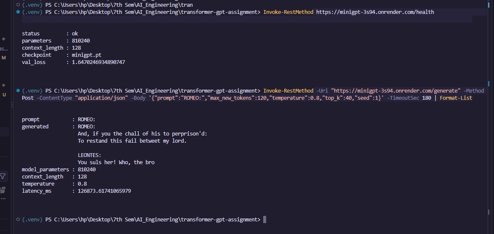

The first request after a period of inactivity is slow (about 2 minutes in the screenshot), because the free Render instance has to wake up. Requests made while the instance is awake are much faster.

**Render.** [`render.yaml`](render.yaml) is a Render Blueprint. Push the repository (including `checkpoints/minigpt.pt`) to GitHub, then in Render choose *New → Blueprint* and select the repo. It installs `requirements-api.txt` (CPU-only PyTorch), starts `uvicorn src.api:app --host 0.0.0.0 --port $PORT`, and uses `/health` as the health check.

> Render's free tier has 512 MB of RAM. The model is tiny, but the PyTorch runtime is not; if the free instance runs out of memory, use the smallest paid instance.

**Docker.**

```bash
docker build -t minigpt .
docker run -p 8000:8000 minigpt
```

No API keys or secrets are used anywhere in the project.

---

## Reproducing everything

The commands follow the order of the handout's submission acceptance tests.

```bash
# 1-2. Install and run unit tests
pip install -r requirements.txt
python -m pytest -q

# 3. Tiny-overfit gate (loss 4.2 -> 0.07)
python -m src.train --run-name overfit --overfit-batch \
       --set train.max_steps=300 --set train.batch_size=16

# Train the final model (config: configs/tiny_gpt.yaml; ~40 min on a 2-core CPU)
python -m src.train --run-name minigpt

# 4-5. Reload the checkpoint in a fresh process and generate
python -m src.generate --prompt "ROMEO:" --max-new-tokens 200 --temperature 0.8
python -m src.evaluate                           # val loss / perplexity + 5 fixed-prompt samples

# Evidence figures
python -m experiments.hand_calculation           # Figures 1-2
python -m experiments.make_evidence              # Figures 3-5 + architecture diagram
python -m experiments.plot_training              # Figure 6
python -m experiments.attention_visualization    # Figure 7
python -m experiments.ablation                   # Figure 9
python -m experiments.mlm_vs_clm                 # BERT vs GPT mask experiment
python -m experiments.generation_strategy        # greedy vs temperature vs top-k/top-p
python -m experiments.seq_vs_parallel            # RNN vs Transformer timing
```

Step 6 of the acceptance tests ("generation never attends to future tokens") is covered by `tests/test_mask.py`.

---

## Tests

```bash
python -m pytest -q
```

36 tests across 7 files:

| File | What it checks |
|---|---|
| `test_attention.py` | scores match the hand calculation; rows sum to 1; masked and unmasked output match a PyTorch reference; √d_k scaling matters |
| `test_mask.py` | mask is strictly upper-triangular; future positions get zero weight; MHA output and full-model logits at t do not change when tokens after t change; a bidirectional model is *not* causal |
| `test_shapes.py` | head split/merge round-trip, MHA shape trace, positional encoding values, block and GPT output shapes, initial loss ≈ ln(V), parameter-count formula |
| `test_overfit.py` | targets are inputs shifted by one; loss collapses on a tiny repeated batch |
| `test_tokenizer.py` | encode/decode round-trip, determinism, `<unk>` policy, serialisation |
| `test_checkpoint.py` | a fresh process reloads a saved checkpoint and generates; the CLI prints the required fields; greedy decoding is deterministic |
| `test_numpy_reference.py` | the NumPy reference's attention, LayerNorm and softmax-cross-entropy gradients match PyTorch autograd |

`F.scaled_dot_product_attention` is used **only inside the tests** as an independent oracle, never in the model.

---

## Design decisions

* **Pre-LayerNorm blocks** (GPT-2 style): normalise *before* each sub-layer, so the residual path is a clean identity and training is stable without careful warm-up.
* **GELU feed-forward** `d → 4d → d`; dropout 0.1 on attention weights, sub-layer outputs and embeddings.
* **Embeddings scaled by √d_model.** Embeddings are initialised N(0, 1/d); without scaling, the ±1-valued positional code would drown out token identity.
* **GPT-2 initialisation.** Weights N(0, 0.02); the output projection of every residual branch is shrunk by 1/√(2N). The initial loss is 4.22 vs ln(66) = 4.19, so the untrained model is correctly uniform.
* **Weight decay on matrices only**, not on biases or LayerNorm gains. Gradient clipping at 1.0.
* **Causal mask** = strictly upper-triangular boolean matrix, filled with `-inf` *before* the softmax.
* **Shifted targets.** The dataset returns windows of T+1 tokens; `x = w[:-1]`, `y = w[1:]`.
* **Fixed validation batches.** Validation uses a fixed seed, so all runs and ablations are scored on the same windows.

### Reference implementation (NumPy, manual backprop)

[`reference/numpy_llm/`](reference/numpy_llm/) contains an earlier implementation of the same architecture in pure NumPy, with hand-derived gradients for attention, LayerNorm, the FFN and softmax cross-entropy. At about 3.5 s per step on CPU it is too slow to train on Tiny Shakespeare, which is why the final model is in PyTorch. `tests/test_numpy_reference.py` ties the two implementations together by checking that every forward value and manual gradient matches PyTorch autograd.

---

## Known limitations

* **Small model, short window.** 0.8 M parameters and a 128-character context (about 20 words). The model learns the format of a play and many real words, but invents words and has no long-range plot or coherence.
* **Greedy decoding loops.** 83 % of its 4-grams are repeats; temperature sampling is needed.
* **Not converged.** There is a train/validation gap of about 0.2 nats and the validation loss was still falling at step 3,000; the model is limited by capacity and compute.
* **Ablations are indicative only.** They use a reduced budget and one seed; differences smaller than the seed-to-seed spread (~0.02) are not meaningful, and the context-length result is confounded with tokens per step.
* **Character-level tokenizer.** Characters outside the training set map to `<unk>`.
* Generated text is an experimental artefact and is not factual.

---

## Sources and attribution

* Vaswani et al., *Attention Is All You Need* (2017): scaled dot-product attention, multi-head attention, sinusoidal positional encoding.
* Radford et al., *Language Models are Unsupervised Multitask Learners* (GPT-2, 2019): pre-LN block and initialisation scheme.
* Devlin et al., *BERT: Pre-training of Deep Bidirectional Transformers* (2018): masked language modelling, used for the mask comparison.
* Tiny Shakespeare: A. Karpathy, *The Unreasonable Effectiveness of Recurrent Neural Networks* / char-rnn; Hugging Face dataset [`karpathy/tiny_shakespeare`](https://huggingface.co/datasets/karpathy/tiny_shakespeare). See [`data/README.md`](data/README.md).
